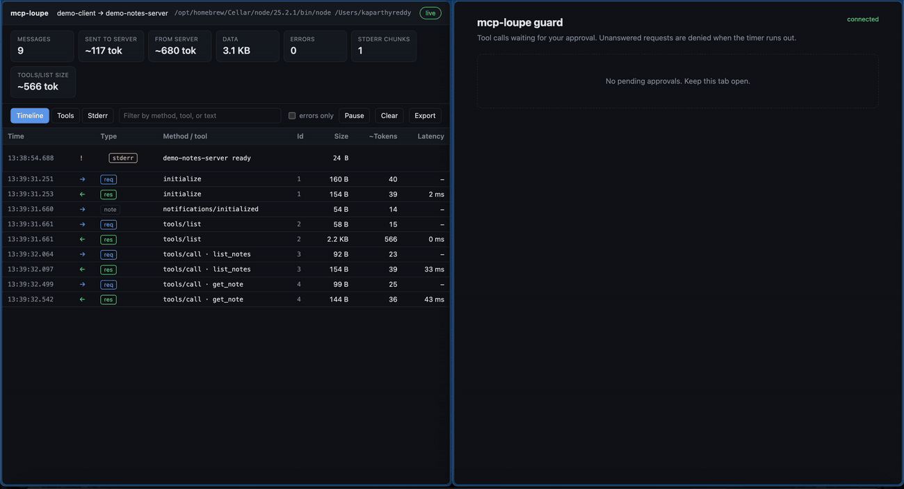
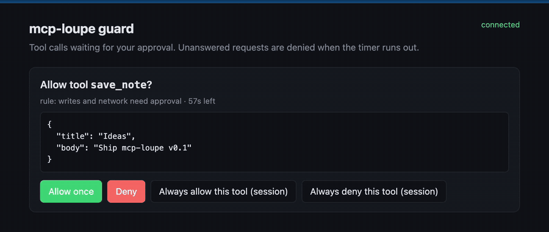

# mcp-lens

[](https://github.com/KaparthyReddy/mcp-lens/actions/workflows/ci.yml)

Observe, guard, and evaluate MCP servers. Zero dependencies. No API keys. Everything runs on your machine.



| Command | What it does |
| --- | --- |
| `mcp-lens run` | Wraps an MCP server, shows every JSON-RPC message in a live local dashboard: tool calls, sizes, estimated tokens, latency, stderr. |
| `mcp-lens run --guard guard.json` | Adds a policy firewall: auto-allow safe tools, block dangerous calls, ask you about the rest. |
| `mcp-lens lint` | Checks tool names, descriptions, and schemas for problems that make models pick tools badly. Fully offline. |
| `mcp-lens eval` | Measures how reliably a local model (Ollama) picks your tools and fills in arguments. Free. |
| `mcp-lens init` | Patches Claude Desktop, Cursor, Claude Code, Windsurf, and Cline configs to wrap your servers. |

## Quick start

Requires Node 18 or newer.

```
git clone https://github.com/KaparthyReddy/mcp-lens.git
cd mcp-lens
node examples/demo-client.js --hold --open
```

That runs a demo client against a demo server and opens the dashboard.

## Observe: `mcp-lens run`

Put `mcp-lens run --` in front of the server command you already use.

Claude Desktop, Cursor, Cline, Windsurf (`mcpServers` JSON):

```json
{
  "mcpServers": {
    "notes": {
      "command": "npx",
      "args": ["-y", "mcp-lens", "run", "--", "node", "/path/to/server.js"]
    }
  }
}
```

Claude Code:

```
claude mcp add notes -- npx -y mcp-lens run -- node /path/to/server.js
```

Or let `mcp-lens init` patch your configs for you. It makes a `.mcp-lens.bak` backup first and can unwrap later.

The dashboard runs at `http://127.0.0.1:7777`. If the port is taken it uses the next free one. Each wrapped server gets its own dashboard.

What you see:
- Timeline of every message with direction, method, tool name, size, estimated tokens, and latency.
- Request and response pairing, with errors, slow calls, and large payloads highlighted.
- Per-tool and per-method stats: calls, errors, avg/p95/max latency, token share.
- Server stderr, filterable.
- Full payload inspector, JSON export, and optional `--log file.jsonl`.

Options: `--port`, `--open`, `--hold` (keep the dashboard up after the server exits), `--no-dashboard`, `--log`.

## Guard: `--guard guard.json`



```
mcp-lens run --guard examples/guard.json -- node server.js
```

The guard reads every `tools/call` before the server does. Rules are checked top to bottom and the first match wins. If nothing matches, `defaultAction` applies.

```json
{
  "defaultAction": "ask",
  "prompt": "web",
  "askTimeoutSeconds": 60,
  "approvalPort": 7778,
  "openBrowser": true,
  "audit": ".mcp-lens/audit.jsonl",
  "rules": [
    {
      "name": "block destructive shell",
      "tool": "run_command",
      "when": [{ "arg": "command", "op": "matches", "value": "rm\\s+-rf" }],
      "action": "deny",
      "reason": "destructive shell pattern"
    },
    { "name": "reads are safe", "tool": ["read_*", "list_*"], "action": "allow" }
  ]
}
```

- **Actions:** `allow`, `deny`, `ask`.
- **Tool match:** a glob (`*`, `?`) or an array of globs.
- **Conditions (`when`, all must match):** `arg` is a dotted path into the arguments, or `*` for all arguments as text. Ops: `equals`, `contains`, `startsWith`, `endsWith`, `matches` (regex), `exists`. Add `"negate": true` to invert.
- **Approvals:** by default a local browser page opens with the pending call (plus a desktop notification on macOS and Linux). Set `"prompt": "tty"` or `"both"` for terminal prompts. Unanswered requests are denied when the timer runs out.
- **Audit log:** every decision is appended as JSONL. The path is relative to the policy file.
- **Blocked calls** return an MCP tool error to the client, so the model sees why and can adapt.

## Lint: `mcp-lens lint`

```
mcp-lens lint -- node server.js
mcp-lens lint --json -- node server.js
```

Exits 1 if any error-level finding exists, so it works in CI.

| Rule | Severity |
| --- | --- |
| `invalid-name`, `missing-description`, `invalid-schema`, `required-undefined`, `duplicate-name`, `no-tools` | error |
| `generic-name`, `short-description`, `vague-description`, `description-repeats-name`, `param-description`, `param-type`, `many-parameters`, `similar-tools`, `too-many-tools`, long descriptions | warn |
| `token-budget`, moderately long descriptions | info |

`similar-tools` uses TF-IDF cosine similarity on names, descriptions, and parameter names to find tools a model is likely to confuse.

## Eval: `mcp-lens eval`

Needs [Ollama](https://ollama.com) and a tool-capable model:

```
ollama pull llama3.2:3b
mcp-lens eval --prompts examples/eval-prompts.json -- node server.js
```

Prompts file:

```json
{
  "prompts": [
    { "prompt": "Open note n2", "expectedTool": "get_note", "expectedArgs": { "id": "n2" } },
    { "prompt": "What is the capital of France?", "expectedTool": null }
  ]
}
```

- `expectedTool: null` means the model should not call any tool.
- `expectedArgs` is a partial match; string values compare case-insensitively.
- Reports tool selection, schema-valid arguments, expected arguments, confusions (expected → got), and a no-LLM lexical baseline for comparison.
- `--runs 3` repeats each prompt with a little randomness to measure consistency. Single runs hide flakiness.
- Options: `--model`, `--ollama <url>`, `--runs`, `--json`. Exits 1 if any prompt fails.

## Limits

- stdio servers only. SSE and streamable HTTP are not supported yet.
- Token counts are estimates (about 4 characters per token), not exact tokenizer output.
- The guard sees MCP traffic only. Built-in client tools (for example a client's own shell or file tools) bypass it.
- Payloads can contain secrets. The dashboard binds to `127.0.0.1` only, but `--log` writes full payloads to disk.

## Development

```
npm test
```

## License

MIT
